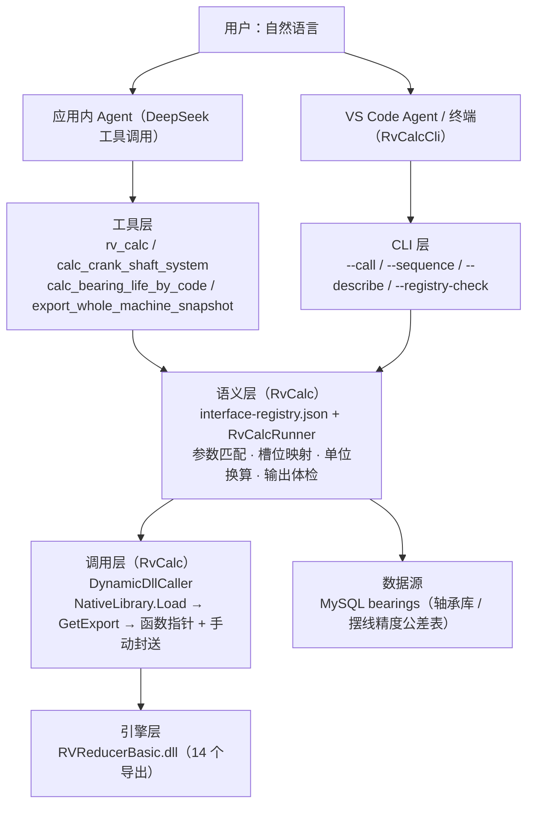
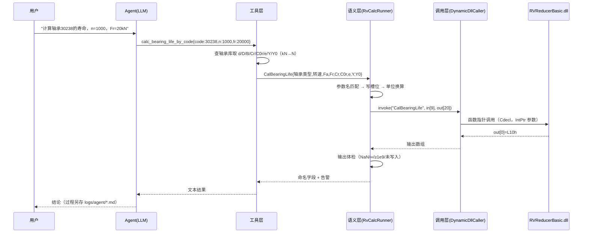

# 自然语言驱动计算 —— 设计流程与设计原理

> 目标：用户用一句自然语言（"帮我算下当前这个减速器工程的曲轴系统，输出安全系数和各节点受力"／"计算轴承 30238 的寿命"），
> 系统能**自己找到该调哪个函数、把参数填对、把结果解释清楚**，并在失配时报错而不是给出"看起来合理"的错值。
>
> 覆盖代码：`RvCalc/`（通用计算层）、`RvCalcCli/`（独立命令行）、`RVReducerDesignApp/Services/`（应用内工具与桥接）。

---

## 1. 背景：为什么需要这样一套设计

### 1.1 三个真实故障

| 现象 | 根因 |
|---|---|
| "RVAutoTest 不全面时就出错" | 每个接口都在 C# 里**硬编码**一套输入数组与默认值；未覆盖的接口没有入口，已覆盖的接口"缺省即静默用默认值" |
| "计算某接口 → 输出明显不合理" | 字段布局（数组下标/单位/量纲）只存在于人的记忆与 C++ 源码里，写错一处不报错，只是结果错 |
| "让 Agent 计算 → 反复试命令 → 达到最大执行轮次" | Agent 手里没有"计算"的工具；它只能试 `run_command`（只允许编译/测试类命令），于是空转到轮次上限 |

### 1.2 归纳出的设计问题

1. **知识放错了地方**：字段布局、单位、默认值应以**数据**形式存在，而不是散落在各处代码里。
2. **失败默认静默**：参数名写错、缺必填、单位不符时"悄悄用默认值"，比报错危险得多。
3. **调用现场重复**：同一个 DLL 导出在各处各写一遍 `[DllImport]`（历史上 `CTAN*`、测试工具、应用内工具各存一份）。
4. **过程与结果混在一起**：Agent 把工具调用流水直接刷在聊天里，用户看不到结论，也留不下可追溯记录。

---

## 2. 总体架构

### 2.1 分层



### 2.2 依赖方向（单向、可裁剪）

```
RvCalcCli ──┐
            ├──► RvCalc（独立类库，零业务依赖）
RVReducerDesignApp ─┘
```

- `RvCalc` 只依赖 BCL；`RvCalcCli` 只依赖 `RvCalc`。
- `RVReducerDesignApp` 通过 `ProjectReference` 引用 `RvCalc`（复用输入构建器与 Agent 工具），删掉引用即可解耦。
- 旧工具 `RVAutoTest` 已于 2026-09-14 移除（源码备份 `_archive/RVAutoTest-source-*.zip`），不参与当前依赖关系。

### 2.3 一次自然语言调用的完整链路



---

## 3. 关键设计原理

### 原则 1：数据驱动，而不是代码驱动
接口的一切"知识"写在 `RvCalc/interface-registry.json`：参数名、别名、槽位、单位、枚举、默认值、输出字段、数组长度、模板文件。
→ **新增一个接口只改 JSON，不改 C#**。

### 原则 2：单一事实来源（Single Source of Truth）
- 数组布局的真源是 **C++ 源码**（`InterfaceForCSharp.cpp` 及各 `ConvertInputDataTo*Obj`、`row[i]` 序号）。
- 输入模板由**已被验证过的构建器**生成（`--dump-templates` 调用 `InvGearInput` / `CycloidGearInput`），避免"手抄 174 个数"。

### 原则 3：语义参数 → 槽位映射
一条参数描述包含：`name/alias`（自然语言键）、`slot` 或 `slots`（写入位置，支持多槽位同步）、
`type`（number/enum）、`unit`、`default`、`required`、`convert`（`deg2rad` / `nm2nmm`）。
例：`行星轮个数` 同时写 `in[67]/in[129]/in[137]/in[166]`；`螺旋角` 写 `in[64]` 并自动 `× π/180`。

### 原则 4：错误不静默（最重要的一条）
| 情形 | 行为 |
|---|---|
| 参数名无法识别 | **拒绝**，并列出该接口可用参数名 |
| 缺必填参数 | 拒绝并指出缺哪个（模板已有非零值则视为已提供） |
| 单位不匹配 / 单位无法识别 | 拒绝并说明期望单位 |
| 全部输出无效 | 判定"调用被拒绝"，附接口说明 |
| 模板缺失但未给数组 | 拒绝并给出修复命令（`--dump-templates`） |

> 设计取舍：宁可"算不出来"，也不要"算出一个错的数"。工程计算里后者代价高得多。

### 原则 5：输出体检
DLL 的失败常常是"不写输出"或"写哨兵值"，因此对每个输出字段检查：
`NaN` / `±∞` / `≥1e9`（历史失败标记）/ **非规格化极小值（≈1e-310，表示该槽位根本没被写入）** / 低于有效下界（如寿命 ≤0、公差 -1）。

### 原则 6：单位与量纲显式化
- 参数可带单位后缀输入（`"23.8 kN"`、`"900 N·m"`、`"2000 rpm"`、`"2 μm"`），按维自动换算；
- 接口级换算用 `convert` 声明：`N·m → N·mm`（摆线力矩量纲要求）、`° → rad`；
- 注册表里也保留"数据库单位是 kN、DLL 需要 N"这类约定注释。

### 原则 7：动态调用取代 N 份 P/Invoke
`DynamicDllCaller` 用统一签名 `int f(IntPtr×5)` + `Marshal.GetDelegateForFunctionPointer`，
按描述分配/拷贝/释放非托管内存：
- 支持 `double[]` / `int[]` / `char**`（字符串数组输出）；
- 缓冲区长度取 **max(注册表声明, 实际提供)**——整机快照的长度由运行数据决定，不能被固定长度卡住；
- 原生访问违例会以 `SEHException` 形式回到托管侧，作为"调用失败"报告，**不会终止宿主进程**。

### 原则 8：有状态依赖显式化
DLL 用全局对象（`gRVReducer`）保存整机状态，某些接口必须"同进程、且先算前置"：
- `--sequence`：在同一进程按顺序执行多步（曲轴系 → 轴推荐 → 应力分布）；
- `arraysFile`：以**整机快照**提供数组级输入（div/idata/ddata/output/out）；
- 快照带 `meta.partial` + `meta.warnings`：轴段未设计时明确标注"不足以驱动曲轴系计算"。

### 原则 9：过程与结果分离
- 聊天/终端只给**最终结论**；工具调用参数与返回写入 `<工作区>/logs/agent/agent-<时间戳>.md`；
- 终端侧提供 `--call` / `--sequence`，便于脚本化与回归；结果可落 JSON。

### 原则 10：可验证性内建
- `--registry-check`：注册表 ↔ DLL 导出双向核对 + 模板就绪检查；
- `--selfcheck`：同一输入分别走静态 `DllImport` 与动态调用器，比对一致性；
- 回归基线（见 §9）用已知算例锁定，任何改动都能一眼比出偏差。

---

## 4. 四类典型调用流程

### 4.1 纯参数接口（如 `CalBearingLife` / `CalCycloidGearStressByObj` / `RecommondPara`）

```powershell
RvCalcCli --call CalBearingLife --args '{"轴承类型":"圆锥滚子","转速":"2000 rpm","Cr":"23.8 kN","C0r":"19.5 kN","径向力Fr":"1750 N","e":0.35,"Y":1.7,"Y0":0.9}'
```

模板打底 → 参数覆盖槽位 → 调用 → 体检 → 输出。

### 4.2 需要整机数据的接口（`CalCrankShaftSystem2` / `RecommondShaftPara`）

```
① 导出快照              ② 数组级驱动                  ③ 有状态依赖用序列
RV_SNAPSHOT_DIR=...  →  --call X --args '{"arraysFile":"snap.json"}'
                        --sequence '[{"interface":"CalCrankShaftSystem2",...},{"interface":"GetForceAndForceLocation"}]'
```

快照来源三选一：环境变量 `RV_SNAPSHOT_DIR`（界面算完自动导出，**原样数组、不复算**）、
启动参数 `--export-snapshot`、应用内工具 `export_whole_machine_snapshot`。

### 4.3 需要"当前设计状态"的接口（应用内）
`calc_crank_shaft_system` 直接对当前工程的 `CTANRVSet` 计算（不导出快照）：
`UpdateClassInputData → 刷新整机输入 → CalCrankShaftSystem2 → GetForceAndForceLocation → 安全系数`。
⚠ 数据存储字典是 WPF 依赖属性，必须在 UI 线程访问（服务内自动 Dispatcher marshal）。

### 4.4 需要数据库的接口
- `calc_bearing_life_by_code`：型号 → 查库（`taperedrollerbearingsinsinglerows` 等）→ 取 `d/_D/B/Cr/C0r/e/Y/Y0` → kN 转 N → 算寿命；
- 摆线四项精度公差由 DLL 内部查库；查库失败时 DLL 返回 `-1`（已修，见 §8）并被体检标为无效。

---

## 5. 自然语言 → 结构化调用的映射规则

1. **参数名**：规范化（去空白/括号/大小写/中英标点）后匹配 → 主名 → 别名 → 枚举项 → 双向包含（"圆锥滚子" 可命中 "圆锥滚子轴承"）。
2. **数值**：数字或"数字+单位"；单位按维换算（force/length/torque/stress/speed/time/angle/density/hardness）。
3. **枚举**：支持中文名、简写、数值；多命中时报错并给出候选。
4. **工具选择原则**（写入系统提示词，抑制乱试）：
   - 算**当前工程**曲轴系 → `calc_crank_shaft_system`（先 `get_design_state` 判前提）
   - 给**型号**查轴承库/算寿命 → `calc_bearing_life_by_code`
   - 算**任意 DLL 接口** → `rv_calc`
   - 导出整机数据 → `export_whole_machine_snapshot`
   - **不要**用 `run_command` 做数值计算（它只能跑编译/测试类命令）
5. **缺前提就说清楚**：例如未设计曲轴 → 直接告知"请先设计曲轴或执行轴推荐"，不空转、不换工具硬试。

---

## 6. 注册表示例（节选）

```jsonc
{
  "name": "CalBearingLife",
  "title": "标准轴承寿命计算",
  "returns": "void",
  "args": [
    { "name": "in",  "type": "double", "length": 9,  "direction": "in"  },
    { "name": "out", "type": "double", "length": 20, "direction": "out" }
  ],
  "params": [
    { "name": "轴承类型", "alias": ["type"], "slot": "in[0]", "type": "enum", "required": true,
      "options": { "深沟球轴承": 1001, "滚针轴承": 1002, "圆锥滚子轴承": 1003, "角接触球轴承": 1004 } },
    { "name": "转速", "alias": ["n","rpm"], "slot": "in[1]", "unit": "r/min", "required": true },
    { "name": "额定动载荷Cr", "alias": ["Cr","C"], "slot": "in[4]", "unit": "N", "required": true }
    // ...
  ],
  "outputs": [
    { "name": "寿命L10h", "slot": "out[0]", "unit": "h", "invalidBelow": 0 }
  ]
}
```

字段含义：`slot` 单槽/`slots` 多槽、`type`(number|enum)、`unit`、`default`、`required`、
`convert`(deg2rad|nm2nmm)、`templateFile`、`outRowWidth`+`rowLabels`（按行展开 142×2 这类输出）、
`complexity`/`note`（提示调用前提）。

---

## 7. 扩展一个计算能力（标准作业）

1. 在 C++ `InterfaceForCSharp.cpp` 找到导出实现，确认**参数顺序/类型、输入分段起点、输出字段含义**；
2. 在 `interface-registry.json` 登记一条（args/params/outputs，必要时 `templateFile`）；
3. `RvCalcCli --registry-check` 核对导出名与模板就绪；
4. 用一组已知算例 `--call` 复算，把数值加入回归基线；
5. 若该能力会被自然语言高频使用，再包一个**专用工具**（像 `calc_bearing_life_by_code` 那样：把"查库/取默认/单位换算"藏进工具里，只暴露用户能说的参数）。

---

## 8. 已知边界与踩坑清单

| 坑 | 现象 | 处理 |
|---|---|---|
| int 数组也要套模板 | 分割索引全 0 → DLL 走错分支 → 输出错乱，甚至堆损坏 | 模板同时作用于 `double[]` 与 `int[]` |
| 轴承类型码是 `100x` | 传 0..4 → `CalBearingLife` 落 else 分支不写输出 → 读到 1e-310 | 以 `PreDefine.h` 宏为准（1001/1002/1003/1004） |
| 两套轴承枚举 | `CalCustomBearingLife` 用 `BearingSpecificType(0..7)`，与标准寿命接口不同 | 注册表分别登记，注释说明 |
| 未写入的槽位 | 读出"非规格化极小值" | 体检规则识别并标记"该槽位未被 DLL 写入" |
| 量纲 | 摆线力矩需 N·mm（UI 以 N·m 传递） | 参数 `convert: nm2nmm`；模板存 DLL 量纲值 |
| 摆线精度查库崩溃 | 等级无数据/DB 不可用 → 堆损坏 `0xC0000374` 终止进程 | 已修 C++：失败分支补 `return`、空 vector 兜底、连接判空；返回 `-1` 并由体检标记 |
| 有状态依赖 | `RecommondShaftPara` 单独调用返回 -1 | 用 `--sequence` 先算 `CalCrankShaftSystem2`；`GetForceAndForceLocation` 同进程才有效 |
| 全局态残留差异 | 快照复算轴长 144.6637 vs 界面 138.6637（差 6.0 mm = `b_Design`） | 在序列里先跑与界面相同的接口链；文档如实说明 |
| 源码编码 | `RVReducerBasic/*.cpp` 并非统一 GBK（如 `TANPinionCycloidGear.cpp` 是 UTF-8 with BOM） | 用 `tools/patch-source-safe.ps1`（自动探测编码 + 防双 BOM + 命中校验） |
| 轴承库列名 | 型号列名是中文 `型号`，外径列名是 `_D`，各表不同 | `SELECT *` + 按列序号读取（对齐 C++ `row[0..8]`） |
| 应用在运行时编译 | `MSB3027/MSB3021` 文件被 VS Debug Adapter 占用 | 停止调试后重编；仅校验编译可用 `-p:BaseOutputPath=obj\vbcheck\` |
| 产物位置 | 曾把临时脚本/快照写到系统临时目录 | 约定：脚本在 `tools/`、日志在 `logs/`、快照在 `RvCalc/templates/`、测试产物在 `screenshots/` |

---

## 9. 回归基线（实测数值，改动后应保持一致）

| 调用 | 关键结果 |
|---|---|
| `CalInvGearStress2`（mn=5, z=20/106, a=315, T=500 N·m, n=1000） | σH=**729.4476** MPa，σF=113.4345/130.65，d=100/530 |
| `CalCycloidGearStressByObj`（默认模板） | 接触应力=**703.45654** MPa，K1=0.81218，D_T=192.687，M_Mf=406.590，公差 5/20/6.5/25 |
| `CalCustomBearingLife`（3,1,Cr=18500,C0r=14600,α=13,Dpw=24.7,Dw=4.8,Z=14,bm=1.15,Fr=1500,n=1000） | L10h=**72240.98** h，S0=9.73333，P=1500 |
| `RecommondPara`（固定件=1, i=153, T=-784 N·m, n=15） | mn=1.75，αn=25°，a=42，Z=10/38，针轮 40 / rz=3 / 摆线 39 |
| `CalInvGearTolerence`（5 级，mn=2，b=20，z=23） | f_pt / f_fα / f_Hβ = **6 / 6 / 6** μm |
| `CalGeometry`（默认） | d=46 / 212 mm，db=43.22586 / 199.21484 |
| 轴承库 `30238` | d=190，D=340，B=55，Cr=732 kN，C0r=1030 kN，e=0.44，Y=1.4，Y0=0.8 |
| 当前工程曲轴系（UI 算例） | 轴径 60 mm，最大弯曲 3.3293 MPa，最大剪 0.15405 MPa，14 个节点 |
| `--sequence` 复算轴推荐（同一快照） | 轴径 70 mm / 轴长 144.6637 mm（节点数 14，与上一条一致） |

---

## 10. 文件职责速查

| 文件 | 职责 |
|---|---|
| `RvCalc/interface-registry.json` | 14 个导出的语义描述（**唯一需要改的知识表**） |
| `RvCalc/RvInterfaceRegistry.cs` | 注册表模型 + 加载（模板缺失只告警） |
| `RvCalc/RvCalcRunner.cs` | 参数匹配/槽位写入/单位换算/输出体检/结果文本 |
| `RvCalc/DynamicDllCaller.cs` | 动态解析导出 + 手动封送（无需 `[DllImport]`） |
| `RvCalc/InvGearInput.cs`、`CycloidGearInput.cs` | 已验证的输入构建器（模板来源） |
| `RvCalcCli/Program.cs` | `--call / --sequence / --describe / --list-interfaces / --registry-check` |
| `RvCalcCli/DevTools.cs` | `--dump-templates` / `--selfcheck` |
| `RvCalcCli/DllBootstrap.cs` | 工作区定位 + DLL 依赖整体复制（含源 DLL 更新自动刷新） |
| `RVReducerDesignApp/Services/WholeMachineSnapshot.cs` | 整机快照导出/自动钩子/相对目录解析 |
| `RVReducerDesignApp/Services/CurrentMachineCalc.cs` | 当前工程曲轴系计算（UI 线程 marshal + 安全系数） |
| `RVReducerDesignApp/Services/BearingCatalog.cs` | 轴承库访问 + 按型号算寿命 |
| `RVReducerDesignApp/Services/Agent/AgentMachineTools.cs` | 应用内工具：`get_design_state` / `calc_crank_shaft_system` / `calc_bearing_life_by_code` |
| `RVReducerDesignApp/Services/Agent/AgentRvCalcTool.cs` | 应用内工具：`rv_calc` / `export_whole_machine_snapshot` |
| `RVReducerDesignApp/Services/Agent/AgentRunLog.cs` | 执行过程落盘（`logs/agent/*.md`） |
| `RVReducerDesignApp/Services/ProjectContextLoader.cs` | 系统提示词：项目背景 + **工具使用原则** |
| `tools/patch-source-safe.ps1` | 编码安全的源码补丁工具（UTF-8 BOM / GBK 混用） |

---

*相关文档：`RvCalc/README.md`（使用手册）、`tools/README.md`（工具与产物约定）。*
